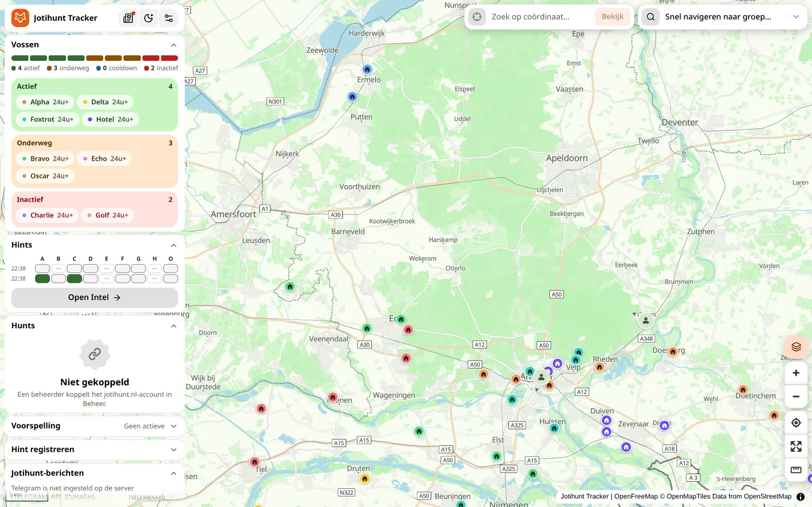
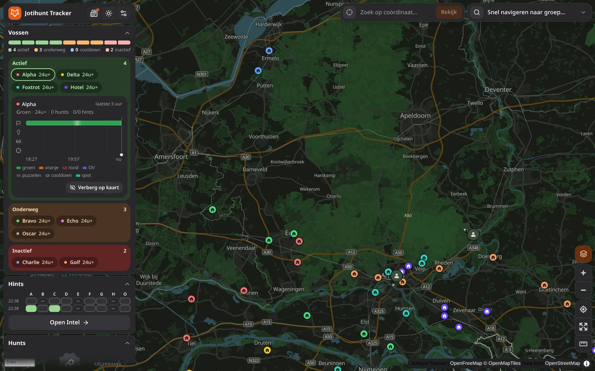
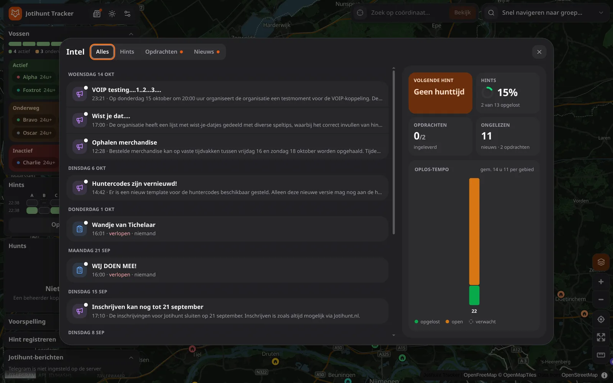
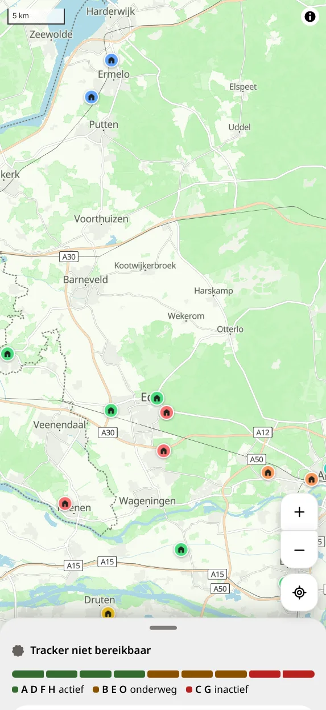
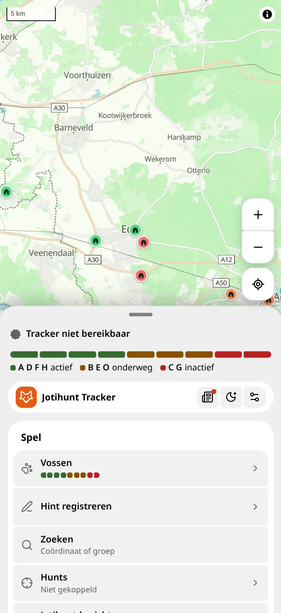
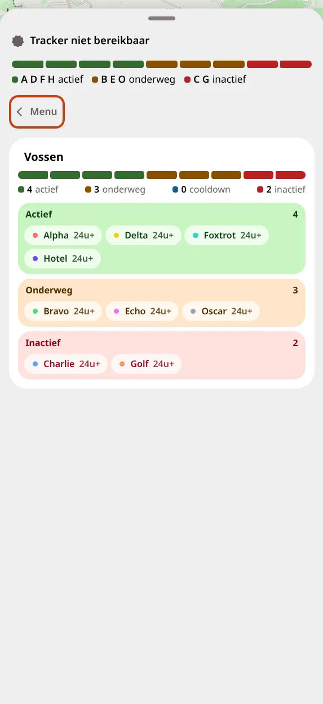
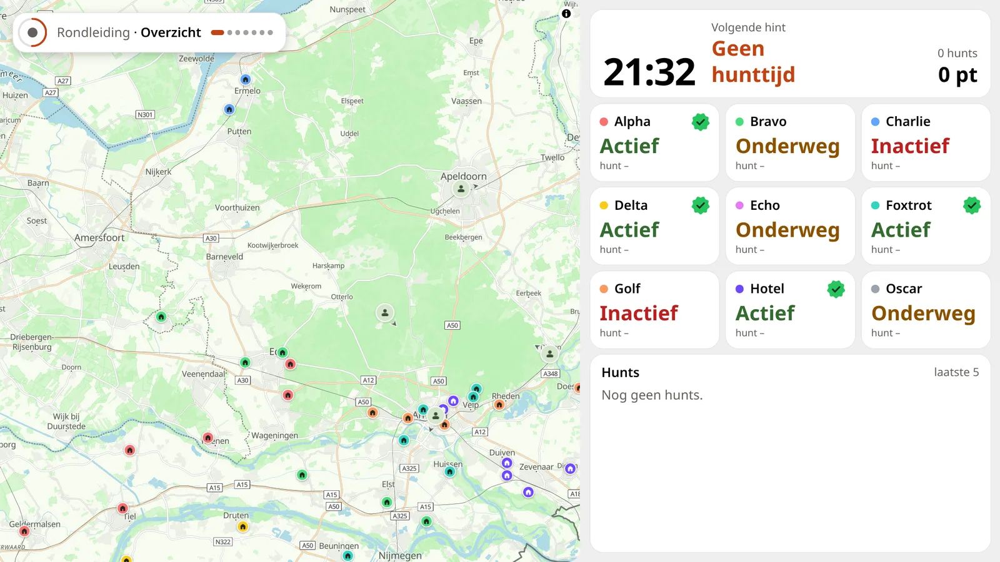
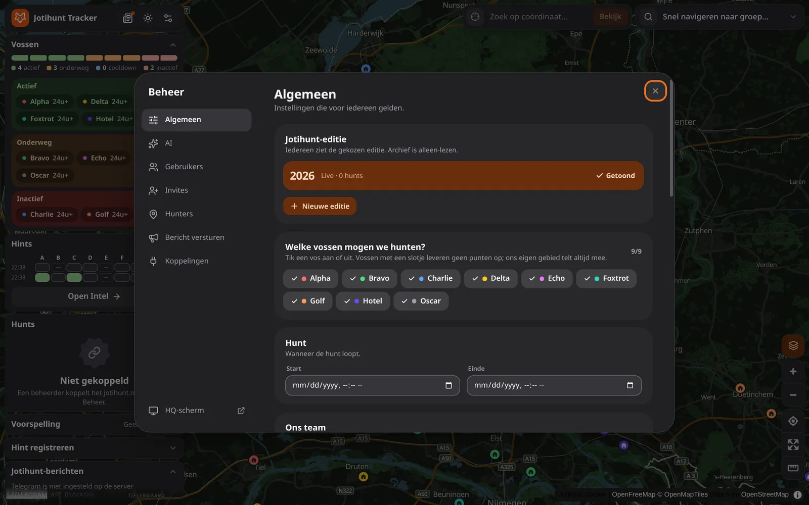
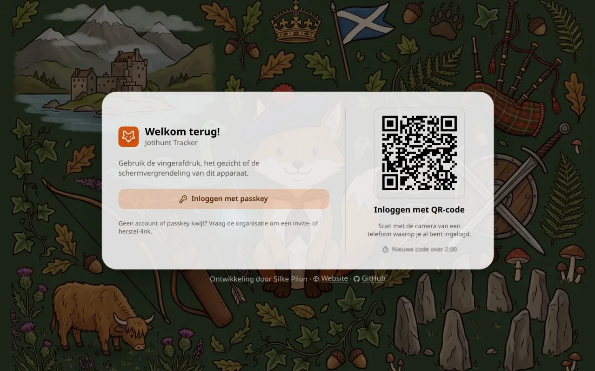

# 🦊 Jotihunt Tracker - Client

Webapp (PWA) voor de [Jotihunt](https://jotihunt.nl): één kaart met de vossen, hints, hunts, groepen en hunters, live bijgewerkt. Op een laptop met zijbalk, op een telefoon met een bottom sheet, en op een beamer als HQ-scherm.

> [!NOTE]
> Werkt alleen samen met de [Jotihunt Tracker Server](https://github.com/ScoutingScherpenzeel/jotihunt-tracker-server); daar staan ook de installatie met Docker Compose en de configuratie van Traccar, Telegram, Life360 en AI.

<p align="center">
  
</p>

## Inhoud

- [Rondleiding](#rondleiding)
  - [Kaart en lagen](#kaart-en-lagen)
  - [Vossen](#vossen)
  - [Hints en hunts](#hints-en-hunts)
  - [Intel en AI-chat](#intel-en-ai-chat)
  - [Telefoon](#telefoon)
  - [HQ-scherm](#hq-scherm)
  - [Beheer](#beheer)
  - [Meldingen](#meldingen)
  - [Inloggen](#inloggen)
  - [PWA en offline](#pwa-en-offline)
  - [Toegankelijkheid en thema](#toegankelijkheid-en-thema)
- [Techniek](#techniek)
- [Aan de slag](#aan-de-slag)
- [Omgevingsvariabelen](#omgevingsvariabelen)
- [Scripts](#scripts)
- [Projectstructuur](#projectstructuur)
- [Deployment](#deployment)
- [Bijdragen](#bijdragen)
- [Licentie](#licentie)

## Rondleiding

De schermafbeeldingen komen uit een demo-omgeving met de echte deelgebieden en groepen van 2026 en verzonnen hunters.

### Kaart en lagen

De kaart draait op [MapLibre GL JS](https://maplibre.org/) met gratis kaartbronnen zonder API-token:

- **Auto** (standaard): OpenFreeMap Liberty in een Material 3-kleurschema, licht of donker met het thema van de app. Dezelfde kaart als in de Android-app.
- **Straten**: vectortegels van [OpenFreeMap](https://openfreemap.org/).
- **Outdoor**: de BRT-achtergrondkaart van [PDOK](https://www.pdok.nl/).
- **Satelliet**: luchtfoto's van PDOK met plaatsnamen van OpenFreeMap.

Via de lagenknop rechts zet je lagen aan en uit:

- **Spel**: groepen, groepscirkels, tegenhunt-cirkel (met windsector tijdens een tegenhunt), markers per speelhelft, AI-voorspelling en het bereik van elke vos (waar hij sinds zijn laatste hint of hunt kan zijn).
- **Team & kaart**: hunters (Traccar), Life360-leden en 3D-gebouwen (3DBAG).
- **Eten**: McDonald's, KFC en Burger King.

Lijnen tussen de locaties van een vos volgen echte paden (looproutes, 's nachts zonder gesloten bossen) zodra de server een router heeft; anders rechte lijnen. Verder: zoeken op coördinaat (RD of WGS84), snel naar een groep navigeren, een liniaal, draaien en kantelen met de muis, en een popup per groep met route en "bezocht".

### Vossen

De kaart **Vossen** groepeert de vossen op status (actief, onderweg, cooldown, inactief) met een statusbalk erboven. Tik op een vos voor de geschiedenis van de laatste drie uur: status, hints, hunts en spots op een tijdlijn. Vossen die met het OV reizen staan apart.

<p align="center">
  
</p>

### Hints en hunts

- **Hint registreren**: kies het deelgebied en de tijd, typ de RD-cijfers. De app controleert live of het punt in Nederland ligt en hoe ver het van de vorige hint is. Onbekende cijfers typ je als `?`: de app toont dan de mogelijke punten.
- **Hints**: een raster per hint-ronde en deelgebied laat zien welke vakken al zijn opgelost.
- **Hunts**: de server haalt de hunts van de groep op van jotihunt.nl (QR-hunts). De kaart **Hunts** toont de synchronisatie en de uitslag; hunts met een locatie staan als marker op de kaart.
- **Markers**: zet zelf een hint, hunt of spot op de kaart, op een gekozen plek of op je eigen locatie.
- **Punten**, **Tegenhunt** en **Jotihunt-berichten** (Telegram) staan als eigen kaarten in de zijbalk; een happy hour toont een badge.

### Intel en AI-chat

**Intel** (knop in de zijbalk of toets `i`) bundelt nieuws, hints en opdrachten in één tijdlijn met ongelezen-stippen. Rechts staan statuskaarten: volgende hint, opgeloste hints, ingeleverde opdrachten en het oplos-tempo per gebied.

Bij elk item kun je een AI-chat (Gemini) openen. De AI kan de gegevens van de app lezen, op de kaart rekenen, OV-reizen zoeken (NS en OVapi), plaatsen en luchtfoto's bekijken en, met **Web** aan, op internet zoeken. **Denk diep** gebruikt een sterker model. De AI stelt antwoorden en opdrachtupdates alleen voor; opslaan doe je zelf. De chat loopt door als je het venster sluit.

<p align="center">
  
</p>

### Telefoon

Op een telefoon is de kaart schermvullend met een bottom sheet. Dicht toont het de vossenstatus; omhoog geschoven het menu met pagina's (Vossen, Hint registreren, Zoeken, Hunts, …). Terug gaat met "‹ Menu" of een veeg naar rechts.

- **Mijn locatie** volgt je tijdens het lopen en houdt het scherm aan.
- **Hunt hier** opent het hunt-formulier op je eigen positie.
- Na een herstart of een door het systeem gesloten app kom je terug waar je was.

<table>
  <tr>
    <td align="center"></td>
    <td align="center"></td>
    <td align="center"></td>
  </tr>
  <tr>
    <td align="center">Kaart</td>
    <td align="center">Menu</td>
    <td align="center">Vossen</td>
  </tr>
</table>

### HQ-scherm

`/hq` is gemaakt voor een beamer of groot scherm: klok, volgende hint, punten, een tegel per vos en de laatste hunts. De kaart vliegt zelf langs de vossen ("Rondleiding") en naar nieuwe gebeurtenissen. Na één klik speelt het scherm ook geluiden af. Te openen via Beheer → HQ-scherm.

<p align="center">
  
</p>

### Beheer

Beheerders stellen alles in vanuit de app, zonder `.env` aan te passen:

- **Algemeen**: Jotihunt-editie (oude jaren als archief), welke vossen we mogen hunten, hunttijden, ons team, voertuiggroepen, login van jotihunt.nl, routes, AI-voorspelling aan/uit, teams herladen.
- **AI**: Gemini-sleutel en een model per AI-functie.
- **Gebruikers**, **Invites** en **Hunters** (live trackers met batterij).
- **Bericht versturen** naar iedereen.
- **Koppelingen**: Telegram, Life360, Jotiboard en de 3D-gebouwencache.

<p align="center">
  
</p>

### Meldingen

Per soort in te stellen (vossenstatus, hints, nieuws, nieuwe hunts, tegenhunt, happy hour, cooldown); berichten van HQ komen altijd door. Meldingen komen als pushbericht (als de server VAPID-keys heeft), als toast met geluid en in de meldingenfeed.

### Inloggen

Er zijn geen wachtwoorden.

- **Passkey**: vingerafdruk, gezicht of schermvergrendeling van het apparaat.
- **QR-code**: de laptop toont een code; scan hem met een telefoon waarop je al bent ingelogd en bevestig door de knop ingedrukt te houden.
- **Invite- en herstel-links** van een beheerder maken een account of een nieuwe passkey.
- In het accountvenster beheer je passkeys, sessies en gekoppelde apparaten. "Mijn tracker" koppelt de Android-app met een code, of een iPhone via Traccar Client.

<p align="center">
  
</p>

### PWA en offline

- Installeerbaar als app (ook met een installatiehulp op iOS), met snelkoppelingen **Hint registreren** en **Vossen** onder het app-icoon.
- Kaarttegels, lettertypes en sprites van de kaart worden gecachet, zodat de kaart blijft tekenen waar je al bent geweest als het netwerk wegvalt. Gegevens van de API worden nooit gecachet.
- Een nieuwe versie wordt pas geladen als je dat bevestigt.

### Toegankelijkheid en thema

- Licht en donker thema (volgt het systeem, of handmatig). Op een laptop gaat de wissel van donker naar licht met een flashbang, behalve met reduced motion.
- Alle animaties volgen `prefers-reduced-motion`.
- Bediening met toetsenbord: `/` zoekt een groep, `i` opent Intel, Enter op de kaart kiest het midden als locatie, en popups krijgen focus en een melding voor schermlezers.
- Op touchscreens zijn kleine knoppen minstens 44 × 44 px aanraakbaar.

## Techniek

| Onderdeel | Gebruikt |
| --- | --- |
| Framework | React 19, React Router, TypeScript |
| Build | Vite, `vite-plugin-pwa` (Workbox), `vite-envs` |
| Styling | Tailwind CSS v4, Radix UI, shadcn/ui-componenten, Vaul (drawers) |
| Animatie | Motion (`motion/react`) |
| Kaart | MapLibre GL JS, `react-map-gl`, Turf, proj4 (RD) |
| Data | SWR, Axios, Zustand |
| Formulieren | React Hook Form, Zod |
| Auth | `react-auth-kit`, `@simplewebauthn/browser` |
| AI-chat | AI SDK (`@ai-sdk/react`), React Markdown |
| Fouten | Sentry |
| Runtime en tests | Bun |

## Aan de slag

Vereist: [Bun](https://bun.sh/) (of `npx bun`) en een draaiende [server](https://github.com/ScoutingScherpenzeel/jotihunt-tracker-server).

```bash
bun install
cp .env.example .env    # zet API_BASE_URL=http://localhost:3000
bun run dev             # http://localhost:5173
```

Zet op de server `WEBAUTHN_RP_ID=localhost` en neem `http://localhost:5173` op in `WEBAUTHN_ORIGINS`, anders werken passkeys lokaal niet. De devserver luistert ook op het netwerk, maar passkeys werken alleen op `localhost` of via `https://`.

## Omgevingsvariabelen

De client heeft maar een paar variabelen; de rest (team, hunttijden, voertuiggroepen, logo, Discord) komt van de server via `GET /config` en stel je in via **Beheer → Algemeen**.

| Variabele | Beschrijving |
| --- | --- |
| `API_BASE_URL` | Adres van de server, bijvoorbeeld `https://api.jotihunt.jouwscoutinggroep.nl` of `http://localhost:3000`. Moet bereikbaar zijn voor de browsers van alle gebruikers. |
| `TEAMS_AREA_EDITING` | `true`: gebruikers mogen deelgebieden van groepen aanpassen. Zelfde waarde als op de server. |
| `SENTRY_DSN` | Optioneel. DSN van het Sentry-project van de website; meldingen gaan via `/sentry-tunnel` van de server (zet daar `SENTRY_SITE_DSN` op dezelfde DSN). |
| `SENTRY_ENVIRONMENT` | Optioneel, bijvoorbeeld `production`. Standaard de Vite-modus. |

Bij het bouwen van het image (optioneel): `GIT_SHA` (release-naam voor Sentry), en `SENTRY_ORG`, `SENTRY_PROJECT` plus het build-secret `sentry_auth_token` om source maps naar Sentry te uploaden. Zonder token wordt er niets geüpload.

## Scripts

| Script | Wat het doet |
| --- | --- |
| `bun run dev` | Vite-devserver op poort `5173`. |
| `bun test` | Unit-tests (Bun). |
| `bun run lint` | ESLint, geen waarschuwingen toegestaan. |
| `bun run build` | Productiebuild naar `dist/` en typecheck (`tsc -b`). |
| `bun run preview` | Serveert `dist/` op poort `80`. |

## Projectstructuur

```text
src/
  pages/          Losse pagina's: kaart (App), Login, Invite, Herstel, QrLink, Hq, Users
  Layout.tsx      Laptop- en telefoonindeling rond de kaart
  Routes.tsx      Routes (/, /hq, /login, /invite/:code, /herstel/:token, /l/:code)
  components/
    map/          Kaart, popups, volgen, liniaal, orbit, lagenpaneel
    layers/       Kaartlagen: markers, groepen, hunters, sporen, bereik, 3D, fastfood, Life360
    sidebar/      Zijbalk en de kaarten daarin (Vossen, Hints, Punten, Tegenhunt, …)
    mobile/       Bottom sheet, menu en pagina's voor telefoons
    intel-window/ Intel-venster en AI-chat
    beheer/       Beheer-venster
    hq/           HQ-scherm
    auth/, account/, tracker/, notifications/, tour/, ui/ …
  hooks/          Data-hooks (SWR) per API-onderdeel
  stores/         Zustand-stores (lagen, instellingen, navigatie, concepten)
  lib/            Logica zonder UI, met tests ernaast (*.test.ts)
  assets/         Kaartstijlen, geluiden, afbeeldingen
public/           Iconen, push-service-worker, screenshots voor de installatie
patches/          Patch voor vaul (wordt bij bun install toegepast)
docs/screenshots/ Afbeeldingen voor deze README
```

## Deployment

### Docker

Bij elke push naar `main` en bij elke release bouwt GitHub Actions `ghcr.io/scoutingscherpenzeel/jotihunt-tracker-client` (tags `main`, de versie en `sha-<commit>`). Het image bevat de gebouwde app; bij het starten zet de container de omgevingsvariabelen in `dist/` en serveert hij op poort `80`:

```bash
docker run -p 80:80 -e API_BASE_URL=https://api.jotihunt.jouwscoutinggroep.nl ghcr.io/scoutingscherpenzeel/jotihunt-tracker-client:latest
```

Een volledige `docker-compose.yml` met server, MongoDB en Traccar staat in de [README van de server](https://github.com/ScoutingScherpenzeel/jotihunt-tracker-server#installatie-met-docker-compose).

### Statische hosting

`bun run build` levert een statische site in `dist/`. De waarden uit `.env` worden bij het bouwen in `index.html` gezet; `dist/vite-envs.sh` kan ze vóór het serveren vervangen met de omgevingsvariabelen van dat moment. Laat de webserver onbekende paden (`/hq`, `/login`, `/invite/...`) naar `index.html` sturen. Passkeys en de service worker vereisen `https://`.

## Bijdragen

- Verbeteringen gemaakt? Open een pull request.
- Een idee maar geen code? Maak een issue.
- Draai `bun test`, `bun run lint` en `bun run build` voor je een pull request opent.
- Elke verandering in de interface hoort te animeren (in, uit en wisselen), met `motion/react` en met respect voor reduced motion.

Gebruik je de tracker bij jullie Jotihunt? Je bent vrij dat te doen (het is open source); we waarderen een bronvermelding en horen graag hoe het in het veld ging.

> [!TIP]
> Bekijk ook de [Jotihunt Discord Notifier](https://github.com/ScoutingScherpenzeel/jotihunt-discord-notifier) en [Jotihunt Telegram Forwarder](https://github.com/ScoutingScherpenzeel/jotihunt-telegram-forwarder) voor het doorsturen van hints, opdrachten en Telegram-berichten naar Discord.

## Licentie

Open source onder de [MIT-licentie](LICENSE).

Gemaakt door [Scouting Scherpenzeel](https://scoutingscherpenzeel.nl/) · [info@scoutingscherpenzeel.nl](mailto:info@scoutingscherpenzeel.nl)
